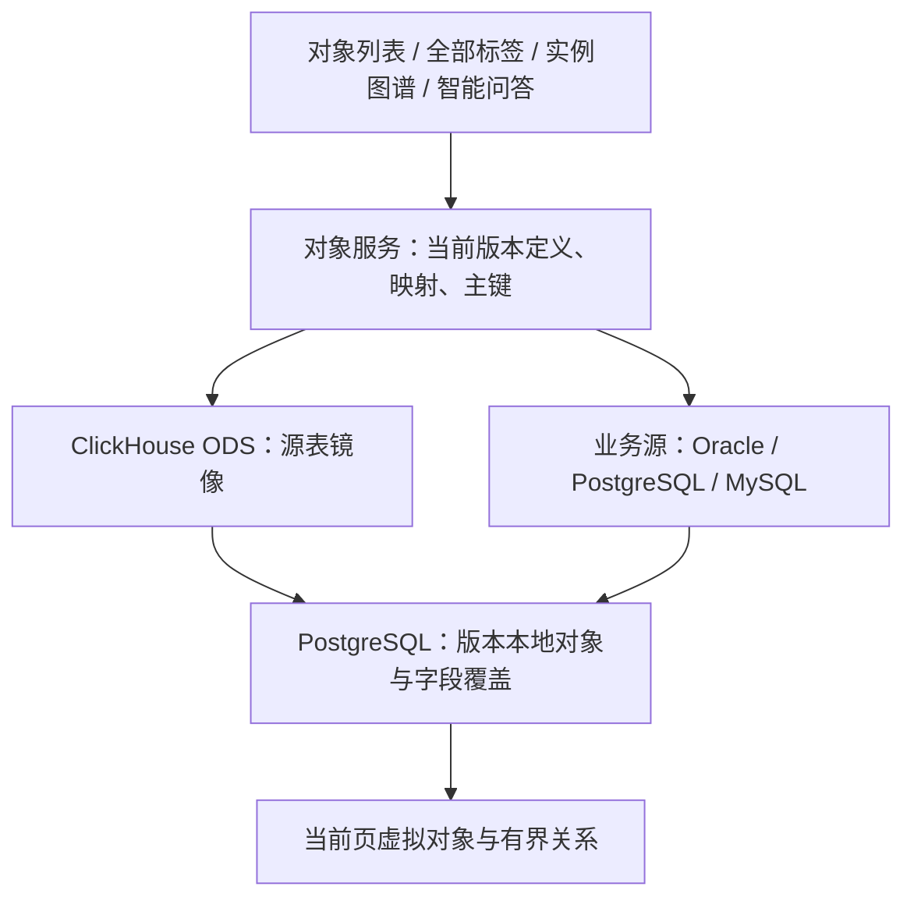

# 第 6 章 · 本体实例与对象检索


<!-- BEGINNER-GUIDE-NOTE -->
> 第一次查看对象或图谱，请先看[常见任务教程](./00B-常见任务教程.md)中的“查看对象、搜索对象和看图谱”。本章详细解释索引、物化与回源。

## 6.1 实例层的三个入口

左侧“本体实例”分组有三个页面：

| 页面 | 用途 | 主要操作 |
| --- | --- | --- |
| 实例图谱 | 看对象与关系构成的图 | 按类型筛选、搜索节点、展开邻居、拖动布局、只读查询 |
| 对象 | 按对象类型管理和查看对象 | 列表、属性详情、主键、一跳关系、编辑、跑动作、取进草稿 |
| 关系 | 查看和管理关系实例 | 按关系类型浏览、创建、编辑、删除、跳到端点对象 |

写入操作只作用于**草稿快照**，需要 `instance.write`；只读操作需要 `instance.read`。如果当前没有草稿，编辑动作会先提示或自动建草稿。

## 6.2 对象身份：对象类型 + 主键

对象服务用一层统一口径识别对象：

```text
对象身份 = (对象类型, 主键值)
对象引用 = 对象类型名/主键串
```

主键来自对象类型的主来源 `sources[0].primaryKey`。支持复合主键：

- 主键值统一转成字符串参与比较和哈希；
- 复合主键按 `列=值&列=值` 的形式表达；
- 主键值缺失、超长或为非标量时，该对象不构成稳定身份；
- 对象索引里的唯一键是对象键 `(对象类型, 主键)`，没有主键时退回 `id:<objectId>`，但这不是业务身份。

对象身份的好处是：

- 对象从索引读还是从业务库回源读，身份一致；
- “取进草稿”天然幂等，同一个对象取两次不会造出第二份；
- 动作、问答、MCP 引用对象时都用同一套引用格式。

## 6.3 对象服务：查询时形成虚拟对象

对象列表、详情、全部标签、实例图谱和问答通过对象服务读取；本体 SQL 通过共享本体语义在 ODS 或业务源执行。查询时按当前版本映射形成对象，不要求提前存储整份对象实例。



来源上的读取路径决定从哪里读：

| 路径 | 行为 |
| --- | --- |
| AUTO | 所需来源的 ODS 镜像完整 READY 时读取镜像，否则读业务源 |
| DIRECT | 直接读业务源 |
| ODS | 必须有完整 READY 镜像及所需列；不满足时报错，不偷偷回源 |

旧 `indexPolicy=AUTO/INDEXED/FEDERATED` 和 `origin=index` 继续被接受，但普通读取统一为虚拟查询，不再选择对象副本。对象类型保存为统一虚拟读法。

“实时形成对象”指映射在查询时执行。ODS 数据新鲜度取决于最后同步时间，不能将镜像查询描述成实时读取原始业务库。

## 6.4 大表使用 ODS 源表镜像

入口：**数据资源 → 表详情 → ODS 镜像**。

1. 选中对象映射需要的列及完整主键（支持复合主键）。
2. 首次执行全量同步，任务在后台运行，可查看进度和取消。
3. 有可靠更新时间列时，可配置增量同步与调度。
4. 增量不自动发现源表删除，应配置周期性全量校准。
5. 在对象类型「属性映射 → 数据来源」配置 AUTO 或 ODS。
6. 回对象列表或图谱查询，无需对象物化。

一张源表一份镜像，多对象类型和版本复用。切换版本只改变定义与映射，不复制整份对象集合。全量取消保留原可用镜像；增量取消可能已提交部分页，镜像暂停读取，重试或校准后恢复。

旧对象物化接口仅保留兼容维护，普通界面已移除入口，旧对象索引和边索引不参与普通读取。存量数据未自动删除；维护约束见 `docs/技术参考/旧对象索引维护.md`。

## 6.5 实例图谱

入口：**本体实例 → 实例图谱**。

### 布局与交互

| 操作 | 说明 |
| --- | --- |
| 按对象类型筛选 | 选择要显示的类型，控制节点数量 |
| 搜索节点 | 按标题或属性搜索，定位后高亮 |
| 展开邻居 | 从节点出发扩展一度邻居，后端无关 |
| 拖动节点 | 拖拽后位置写入当前草稿快照 |
| 布局切换 | 力导向 / 圆形 / 按逻辑分组等（以界面实际提供为准） |
| 节点详情 | 查看属性、主键、对象类型和一跳关系 |
| 只读查询 | 图谱页可展开只读查询；内置图与 Jena 共用同一套模板 |

约束：

- 图谱默认显示数量有上限（常见默认 200 个节点 / 200 条边），可在本机显示设置里调整；
- 位置写回需要 `instance.write`；没有权限时只影响本地视图，不会落库；
- 只读查询写入一律拒绝，避免绕过版本边界；
- 图谱初始加载、草稿预览、从数据源加载和展开邻居，均按指定版本读取虚拟对象及业务关系，并合并版本本地关系；不回退到对象索引或图库实例。
- 关系边需要配好两端键映射和关系数据来源；没有配置时页面如实说明，不会凭对象名称猜边。
- 图谱“邻域范围”可选择 1～3 跳，用于加载业务对象和展开邻居。节点最多 500、边最多 2000；撞上限会提示截断，端点无法读取的边不会渲染。复合主键保持完整列值配对参与查询。

## 6.6 对象页

入口：**本体实例 → 对象**。

### 能做什么

| 操作 | 说明 |
| --- | --- |
| 按对象类型浏览 | 选择类型后列出对象 |
| 全部标签 | 按定义中的类型顺序逐类型查询当前页及计数，合并本地对象，无需物化 |
| 数据读取路径 | 由对象类型数据来源设置 AUTO / DIRECT / ODS，不再切换对象索引 |
| 属性筛选与排序 | 按等于 / 不等于 / 包含 / 大于 / 小于 / 集合 / 有值筛选；支持多列排序，均下推业务库 |
| 看属性 | 展示属性、显示名、主键、来源列与值 |
| 看一跳关系 | 按两端键映射从 ODS / 业务源读取；未配置映射时说明原因 |
| 编辑属性 | 先取进草稿，再修改属性 |
| 跑动作 | 对对象执行动作；对象只存在于业务库时先取进草稿 |
| 取进草稿 | 按对象类型 + 主键把业务库对象写入草稿快照，幂等 |
| 查看绑定缺口 | 对象类型还差数据来源绑定时给提示，并提供跳转入口 |

### 取进草稿规则

1. 对象身份是确定性的：同一个对象取两次还是同一条；
2. 取进草稿只写平台库草稿快照，**不写业务库**；
3. 如果必填属性没有映射来源列，取进草稿永远填不上值；平台会直接报错并指向“本体建模”去补映射或取消必填；
4. 有权限限制时，界面会提示先补 `ontology.write` / `instance.write`，而不是给一个空白页。

> 动作默认作用在草稿编辑层。显式启用动作写回时，已有业务行可通过受控 UPDATE 更新；干跑永远不写业务库。

### 版本编辑层

源对象取进草稿时保存一份源基线。之后只覆盖人工或动作改过的字段；源库刷新时，未改属性继续随源更新。本地新建对象也随版本保存，不要求先写入对象索引。源对象的主键不能修改。

在对象详情点“恢复源数据”可撤销该对象的覆盖修改及草稿本地关系。删除源对象表示在当前版本隐藏，不删除源业务行。要写业务库，继续通过显式开启的动作写回。

涉及覆盖字段的筛选、排序，以及存在未写回编辑的本体 SQL 统计，目前会明确拒绝不完整口径；可按主键查看合并对象，或通过动作写回并同步 ODS 后统计。

### 全部标签的分页边界

按定义中的类型顺序拼接，各类型先显示本地对象，再查询按主键排序的源对象。只读取当前页需要的行，不把全表加载到内存。总数无法精确取得时显示未知；此时跨类型偏移分页不能保证不漏项，平台提示选择具体类型，不伪造完整结果。某个类型读取失败时保留其它类型，并明确提示结果不完整；不会把失败当成零条数据。

普通交互优先返回当前页，拿满后不再继续查询其它类型或计算跨类型总数；总数显示未知，不影响当前页对象的完整属性。接口需要精确计数时可传 `count=1`，仍可能因为源端不支持统计或版本墓碑而返回未知。离开页面会取消当前读取；已经发给源库的一次查询可能需要执行结束，后续类型不再继续读取。

### 历史数据与按需预热

对象页“历史数据”可显式采集所选类型，任务在后台运行。采集结果按页 gzip 压缩保存在 PostgreSQL，并冻结采集所用定义；历史查看不再查询当前业务数据。只有完整完成的采集可被当作历史快照查询。

快照记录采集开始与结束的区间，跨表不承诺同一事务时点。当前冻结源对象投影，人工编辑另由版本编辑层保存。可以分页查看、取消采集、删除快照或预热当前页；预热解压缓存上限 8 MiB、10 分钟，原始压缩页仍持久保存在数据库。

## 6.7 关系页

入口：**本体实例 → 关系**。

| 操作 | 说明 |
| --- | --- |
| 按关系类型浏览 | 选择关系类型查看边与端点对象 |
| 按对象筛选 | 从某个对象出发看它的关系 |
| 新建关系 | 端点对象的类型必须符合关系类型定义 |
| 编辑关系 | 可改关系属性；端点变更要重新校验契约 |
| 删除关系 | 只影响草稿快照 |
| 跳到对象 | 从端点直接打开对象详情 |

关系实例读写都要求对象类型和关系类型来自同一个版本草稿；不能把草稿的关系指向已发布版本的旧 id。

## 6.8 实例数据的三个来源

看待“对象数据”时，要分清三层：

| 层 | 存什么 | 是否权威 | 读法 |
| --- | --- | --- | --- |
| 业务库 | 真实对象数据与关系数据 | 是，业务系统的事实来源 | 平台通过只读事务回源 |
| 平台版本快照 | 发布版本的实例快照与草稿实例 | 版本的权威副本 | 定义发布、版本编辑与本地对象的依据 |
| 图存储 | 发布后的投影 | 否，可重建 | 实例图谱、关系遍历、SPARQL/只读查询 |
| ODS 源表镜像 | ClickHouse 中的原始列副本 | 否，可重建 | 查询时按当前版本过滤、关联并形成对象 |


所以出现“业务库里明明有数据，图谱里没有”时，先分清楚是：

1. 对象类型没有绑定数据来源；
2. 来源未绑定、ODS 不可用或筛选条件没有命中；
3. 当前看的是草稿而不是已发布版本；
4. 图存储读的是发布投影，而没有重新发布。

第 14 章有对应的排查路径。

## 6.9 权限与审计

| 操作 | 权限 | 审计动作 |
| --- | --- | --- |
| 查看对象 / 关系 / 图谱 | `instance.read` | 一般只读，不逐个写变更记录 |
| 新建/修改/删除对象 | `instance.write` | `DRAFT_ENTITY_CREATED/UPDATED/DELETED` |
| 新建/修改/删除关系 | `instance.write` | `DRAFT_RELATIONSHIP_CREATED/UPDATED/DELETED` |
| 保存图谱位置 | `instance.write` | `DRAFT_POSITIONS_UPDATED` |
| 取进草稿 | `instance.write` | 随对象创建审计 |
| 同步索引 | `instance.write` | `OBJECT_INDEX_SYNCED` |
| 重建索引 | `instance.write` | `OBJECT_INDEX_REBUILT` |
| 对象检索 | `instance.read` | 不写变更记录 |

## 6.10 当前限制

- 对象服务默认读已发布版本；草稿实例只能在对象页的草稿预览里操作。
- ODS 是派生镜像，业务库变化需同步后才在镜像中可见。
- 动作、属性编辑只写草稿快照，不回写业务库。
- 实例查询时生成，大表通过 ClickHouse ODS 承载，千万行性能尚未压测。
- 向量检索缺少 embedding 提供方，暂不可用。
